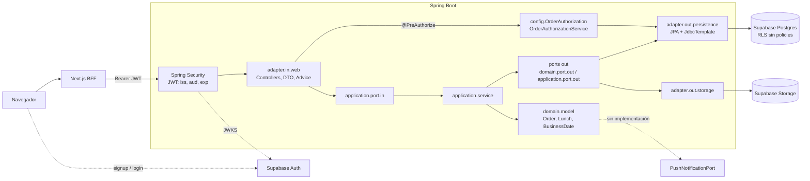
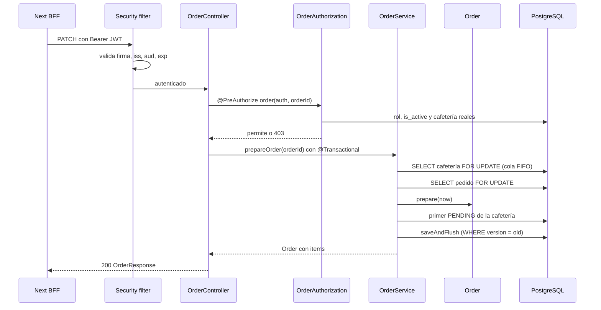
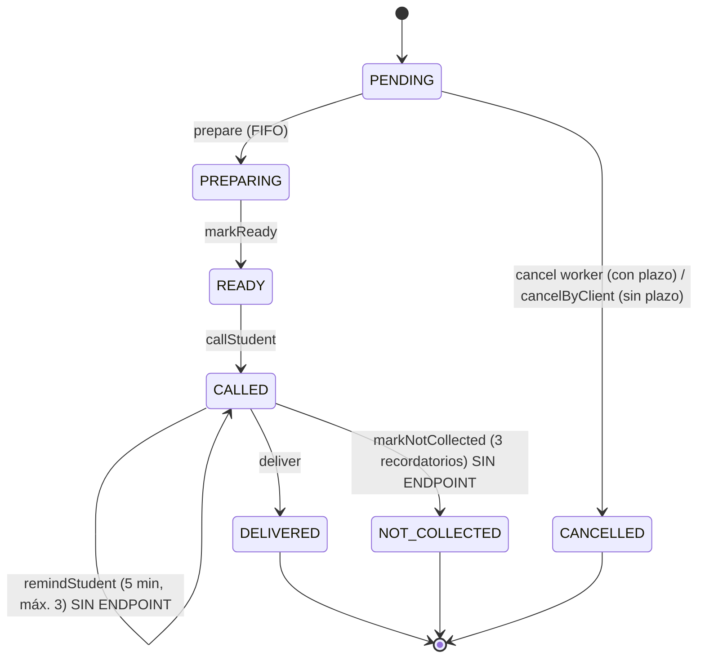

# Auditoría del backend de UniFood

- **Fecha:** 2026-11-03
- **Rama y commit:** `feature/admin-dashboard` @ `618d47c`. El último commit que toca el backend es `3a13af7`; `unifood-backend` no tiene cambios locales.
- **Alcance:** `unifood-backend/` (176 clases Java de producción, 43 clases de test, 17 migraciones, 25 archivos SQL de recursos), más lo indispensable de `unifood-web/` para saber qué endpoints se usan.

**Abreviaturas de rutas**

| Prefijo | Ruta |
| --- | --- |
| `J/` | `unifood-backend/src/main/java/com/santotofood/` |
| `T/` | `unifood-backend/src/test/java/com/santotofood/` |
| `R/` | `unifood-backend/src/main/resources/` |
| `M/` | `unifood-backend/supabase/migrations/` |

**Nivel de evidencia de cada hallazgo**

| Marca | Significado |
| --- | --- |
| **[E]** | Reproducido en ejecución |
| **[L]** | Comprobado leyendo el código |
| **[I]** | Inferencia razonada, pendiente de medir |

**Qué se ejecutó y qué no**

- Se ejecutaron 304 tests sin PostgreSQL: **todos pasaron**.
- **No** se ejecutaron las clases `*PostgresTest`, porque aplican migraciones en un clúster temporal y esta fase las prohíbe.
- No se conectó a Supabase ni se leyeron los valores de `.env`.
- Una prueba desechable fuera del repo reprodujo el hallazgo A5.
- Este informe es el único archivo creado en el repositorio.

---

## 1. Resumen ejecutivo

El backend tiene una base técnica sólida: arquitectura hexagonal respetada en lo esencial, dominio libre de Spring y JPA, autorización contra la base de datos en cada petición, concurrencia bien resuelta y permisos cerrados en Supabase. **No encontré hallazgos críticos de seguridad ni IDOR**: un estudiante no puede actuar sobre pedidos ajenos y una cafetería no puede operar pedidos de otra.

El riesgo principal es de **completitud funcional y de preparación para producción**. Recordatorios y «no recogido» existen en el dominio pero no tienen endpoint. Tampoco existen la creación de pedidos, la notificación al estudiante ni la caducidad de pedidos abandonados.

En calidad, las rutas inexistentes, los 405 y los parámetros faltantes responden 500. No hay CI, Dockerfile, migraciones automatizadas, rate limiting ni medición de cobertura, y Tomcat 11.0.24 tiene CVE públicos con corrección disponible. La mayoría de las correcciones son pequeñas; lo más caro es completar el ciclo de pedidos.

---

## 2. Mapa de arquitectura y stack

### 2.1 Stack real

| Área | Tecnología | Fuente |
| --- | --- | --- |
| Lenguaje y build | Java 21, Maven 3.9.16 (wrapper) | `pom.xml:30`, `.mvn/wrapper/maven-wrapper.properties` |
| Framework | Spring Boot 4.0.8, Spring Framework 7.0.9, Spring Security 7.0.7, Spring Data 2025.1.7 | `pom.xml:8`, BOM local |
| Persistencia | Hibernate 7.2.24, JPA (solo pedidos), `JdbcTemplate` y SQL en archivos (resto), HikariCP 7.0.2, pgjdbc 42.7.13 | BOM local |
| Servidor y JSON | Tomcat 11.0.24, Jackson 3.1.5 (`tools.jackson`) | BOM local |
| Base de datos y auth | PostgreSQL en Supabase, Supabase Auth con JWT validado como OAuth2 Resource Server | `application.properties:3,10-11` |
| Archivos | Supabase Storage, bucket `product-images`, llamado por `HttpClient` | `J/adapter/out/storage/SupabaseProductImageStorage.java` |
| Calidad | Spotless con google-java-format (`ratchetFrom origin/develop`), JUnit 6, Mockito | `pom.xml:146-158` |
| Sin usar | `spring-boot-starter-websocket`; `PushNotificationPort` no tiene implementación | `pom.xml:58-60` |

**Servicios externos reales:** Supabase Postgres, Auth y Storage. **No hay** proveedor de push, email ni SMS desde el backend. El email de confirmación lo gestiona Supabase, con plantilla en `supabase/templates/confirmation.html`.

**Configuración:** un único `application.properties` sin perfiles; las variables se inyectan por entorno y `start-backend.ps1` las carga desde `.env` en local. **No hay Dockerfile, compose, CI/CD ni manifiestos de despliegue** en ningún formato. El backend no sirve al navegador directamente: pasa por el BFF de Next.js.

### 2.2 Vista de componentes

### 2.3 Flujo de una petición: `PATCH /api/orders/{id}/prepare`

Los demás casos siguen el mismo patrón, sin el lock de cafetería. Dos excepciones: los módulos ADMIN autorizan **dentro** del servicio y de la transacción, y WORKER obtiene su cafetería de la base de datos, nunca de la URL.

### 2.4 Máquina de estados del pedido

**Veredicto [L]:** la máquina es **consistente**. Cada método exige un único estado de origen (`J/domain/model/Order.java:92-230`), no hay transición que salte pasos, los terminales no tienen salida y `OrderTest` cubre los rechazos. Las debilidades están alrededor de ella: A1, A2 y M14.

### 2.5 Estado de las dependencias hacia adentro

| Regla | Resultado | Evidencia |
| --- | --- | --- |
| Dominio sin Spring, JPA ni adaptadores | **Cumple** | Sin imports de esos paquetes en `J/domain`; solo Lombok y `shared.error` |
| Aplicación sin adaptadores, JPA, web ni JDBC | **Cumple** | Sin imports en `J/application` |
| Controllers sin lógica de negocio | **Cumple** en lo esencial | La validación de entrada estricta vive en el adaptador web |
| Entidades JPA separadas del dominio | **Cumple** | `J/adapter/out/persistence/mapper/*` |
| Aplicación independiente de Spring | Parcial, decisión pragmática | `@Service`, `@Transactional`, `TransactionTemplate` |
| Entrada por puertos | Parcial | Ver M13 |

---

## 3. Hallazgos por severidad

### Crítico

Ninguno. No encontré un fallo explotable que comprometa datos, autenticación o aislamiento entre sedes. Esto no cubre la configuración remota de Supabase ni el rol real de producción; ver sección 6.

### Alto

#### A1. Recordatorios y «no recogido» no son accesibles por API [L]

- **Descripción:** `RemindStudentUseCase` y `MarkOrderNotCollectedUseCase` están implementados y probados, pero ningún controller los inyecta. El BFF tampoco tiene esas rutas, y `OrderResponse` no devuelve `calledAt`, `reminderCount` ni `lastRemindedAt`.
- **Evidencia:** `J/adapter/in/web/OrderController.java:24-29`, `J/application/service/OrderService.java:118-129` y `148-159`, `J/adapter/in/web/dto/OrderResponse.java:9-21`, `unifood-web/features/orders/api/orderApi.ts:8-17`.
- **Riesgo e impacto:** un pedido `CALLED` solo puede salir a `DELIVERED`. Los estudiantes que no recogen quedan activos para siempre, y las métricas de no recogidos del dashboard y del historial solo pueden valer cero salvo escritura manual por SQL. `T/adapter/in/web/error/GlobalExceptionHandlerTest.java` incluso usa una ruta `/remind` que no existe.
- **Corrección:** añadir `PATCH /api/orders/{id}/remind` y `/not-collected` con `@orderAuthorization.order`, exponer esos campos en `OrderResponse`, extender el BFF y añadir tests de rol.

#### A2. Los pedidos abandonados no caducan y fuerzan datos falsos [L]

- **Descripción:** el listado operativo devuelve los estados activos **sin límite de fecha** y la cola FIFO se aplica a toda la historia de la cafetería. Pasado `cancellationDeadline`, el worker ya no puede cancelar.
- **Evidencia:** `J/adapter/out/persistence/repository/SpringDataOrderRepository.java:31-32`, `J/application/service/OrderService.java:72-79`, `J/domain/model/Order.java:222`.
- **Riesgo e impacto:** un `PENDING` de ayer impide preparar los pedidos de hoy. La única salida por API es recorrer todo el ciclo y marcarlo `DELIVERED`, lo que falsea ventas, o que lo cancele el propio estudiante. El listado, además, crece sin paginación.
- **Corrección:** decidir la regla (pregunta 2) e implementarla en dominio: cierre al terminar el día de negocio, o cancelación operativa con motivo. Acotar `findOperational`.

#### A3. No existe creación de pedidos ni consulta propia, y el stock no se compensa [L]

- **Descripción:** no hay `POST` de pedidos, listado de pedidos del estudiante ni catálogo para clientes. El frontend de cliente usa mocks. Esta ausencia está documentada como pendiente, pero condiciona todo lo demás. `Lunch.decreaseStock` y `increaseStock` no se llaman desde ningún servicio, y la cancelación no devuelve stock.
- **Evidencia:** sección «Items y creación futura» de `unifood-backend/supabase/README.md:65-78`, `unifood-web/docs/client-shopping.md:96-100`, `J/domain/model/Lunch.java:85-105`, `J/application/service/OrderService.java:163-182`, `M/010_backend_business_authority.sql:24`.
- **Riesgo e impacto:** el sistema no opera de extremo a extremo. Además, `Lunch.decreaseStock` lanza `IllegalStateException`, que hoy se traduce en 500 y no en un 409 de negocio. `decrease_lunch_stock` está revocada a `PUBLIC`, así que el rol Spring podría no poder ejecutarla si no es propietario.
- **Corrección:** diseñar `CreateOrderUseCase`: leer catálogo y disponibilidad en servidor, calcular importes, guardar snapshots y descontar stock en una transacción, con idempotencia y compensación al cancelar. Definir un error de dominio para stock insuficiente.

#### A4. El estudiante no recibe ninguna notificación [L]

- **Descripción:** `PushNotificationPort` no tiene implementación ni usuarios, y las tablas `notifications` y `notification_preferences` no tienen escritores. «Llamar al estudiante» solo cambia una columna.
- **Evidencia:** `J/domain/port/out/PushNotificationPort.java`, `J/domain/model/Order.java:118-130`, `M/001_initial_schema.sql:196-216`.
- **Riesgo e impacto:** el llamado y los futuros recordatorios no llegan a nadie, lo que invalida la regla de «no recogido tras tres recordatorios».
- **Corrección:** implementar el puerto en `adapter/out` y enviar **después del commit**, idealmente con una tabla outbox para no perder avisos. Elegir canal (pregunta 3).

#### A5. Errores del cliente responden 500 y ensucian los logs [E]

- **Descripción:** `GlobalExceptionHandler` no extiende `ResponseEntityExceptionHandler` y captura `Exception`, de modo que los errores estándar de Spring MVC caen en el 500 genérico.
- **Evidencia:** `J/adapter/in/web/error/GlobalExceptionHandler.java:126-163`, `J/adapter/in/web/InstitutionController.java:30-35` y `53-58`.
- **Reproducción contra el handler real:**

| Caso | Esperado | Obtenido |
| --- | --- | --- |
| Ruta inexistente | 404 | **500** |
| Método incorrecto | 405 | **500** |
| Query param faltante, p. ej. `GET /api/orders` sin `cafeteriaId` | 400 | **500** |
| Media type no soportado | 415 | **500** |
| Institución inexistente (`IllegalArgumentException`) | 404 | **500** |

- **Riesgo e impacto:** contrato HTTP incorrecto para los módulos que dependen del handler global. Además, cualquier usuario autenticado genera trazas `ERROR` a voluntad, lo que degrada las alertas y facilita inundar logs. No se expone ningún detalle interno: la respuesta es segura, solo incorrecta.
- **Corrección:** extender `ResponseEntityExceptionHandler` o manejar esas excepciones de forma explícita, conservando el formato `ApiErrorResponse`. Devolver 404 de negocio en instituciones y añadir tests.

#### A6. Sin CI/CD, imagen de despliegue ni migraciones automatizadas [L]

- **Descripción:** no hay pipeline, Dockerfile ni herramienta de migraciones. El esquema se aplica manualmente en el editor SQL de Supabase, y `ddl-auto=validate` solo detecta el desfase al arrancar.
- **Evidencia:** ausencia de `.github/` y equivalentes, `unifood-backend/supabase/README.md:198-201`, `application.properties:6`, `pom.xml:151`.
- **Riesgo e impacto:** los puntos de la DoD de `ESTANDARES.md:38` dependen de la disciplina manual. Un error humano en el orden de migraciones afecta directamente a producción, y no queda registro de qué versión tiene cada entorno. Spotless con `ratchetFrom` solo revisa cambios frente a `origin/develop`.
- **Corrección:** pipeline en PRs con `mvnw verify`, `spotless:check` y análisis de dependencias. Dockerfile multi-stage no root. Adoptar Flyway o el CLI de Supabase con tabla de versiones, marcando 001-017 como línea base.

### Medio

#### M1. Tomcat 11.0.24 con CVE públicos y sin análisis de dependencias [L]

- **Descripción:** Spring Boot 4.0.8 gestiona Tomcat 11.0.24, publicado el 2026-07-08. La [página de seguridad de Tomcat 11](https://tomcat.apache.org/security-11.html) lista correcciones en 11.0.25, 11.0.26 y 11.0.27, entre ellas CVE-2026-65182, CVE-2026-68569 y CVE-2026-77791.
- **Evidencia:** `pom.xml:8`, propiedad `tomcat.version` del BOM.
- **Riesgo e impacto:** por eso es Medio y no Alto: no se usa AJP, FORM auth, RewriteValve ni restricciones de seguridad del contenedor (Spring Security trabaja en filtros), y HTTP/2 no está activado. La aplicabilidad exacta de cada CVE no se verificó. El starter WebSocket añade superficie innecesaria.
- **Corrección:** subir a una versión de Boot que incluya Tomcat ≥ 11.0.27 o fijar `tomcat.version`; retirar el starter WebSocket; añadir OWASP Dependency-Check o Dependabot.
- **Nota:** las versiones ≥ 4.0.7 ya incluyen las correcciones de [CVE-2026-40976](https://github.com/advisories/GHSA-8v8j-3hxp-93wr) y [CVE-2026-41001](https://spring.io/security/cve-2026-41001/). No pude confirmar cuál es la última versión de Boot 4.0.x ni si existen avisos de Spring Security 7.0.7 o Framework 7.0.9; hay que comprobarlo en [spring.io/security](https://spring.io/security).

#### M2. Transacciones de pedidos sin timeout, OSIV activo y pool por defecto [L]

- **Descripción:** las escrituras de `OrderService` usan `@Transactional` sin `timeout`, mientras los demás módulos usan 15 s. `FOR UPDATE` espera sin límite. `spring.jpa.open-in-view` queda en `true` por defecto, y Hikari usa su configuración por defecto.
- **Evidencia:** `J/application/service/OrderService.java:55-177`, `application.properties` (sin `open-in-view` ni `hikari.*`), metadatos de `spring-boot-jpa-4.0.8`.
- **Riesgo e impacto:** una transacción colgada puede acumular hilos esperando el mismo pedido o la misma cafetería hasta agotar el pool, incluida la autorización previa a cada operación. OSIV no aporta nada aquí, porque las entidades no tienen relaciones perezosas.
- **Corrección:** `timeout = 15` y `jakarta.persistence.lock.timeout` en órdenes; `spring.jpa.open-in-view=false`; pool dimensionado frente al límite real de Supabase. Mapear `TransactionTimedOutException` a 503, como hacen los demás módulos.

#### M3. Sin rate limiting en el backend [L]

- **Descripción:** no hay ningún límite por usuario ni IP en Spring ni en el BFF. El BFF solo traduce los 429 de Supabase Auth.
- **Evidencia:** búsqueda sin resultados de limitadores en `J/` y `unifood-web/`; `J/config/SecurityConfig.java:35-42`.
- **Riesgo e impacto:** cada petición autenticada consulta la base al menos una vez, y las más costosas son dashboard e historial. El spam de recordatorios **sí** está acotado por dominio: 5 minutos y máximo 3. La creación de pedidos, cuando exista, necesitará su propio límite.
- **Corrección:** limitar en borde o BFF por usuario, y por caso de uso en dashboard, historial, subida de imágenes y creación de pedidos. Con varias instancias, usar un almacén compartido.

#### M4. El dashboard recorre todo el historial de la cafetería [I]

- **Descripción:** `events.sql` filtra por `cafeteria_id` y `delivered_at` o `not_collected_at`, **sin** predicado de `status`, así que los índices parciales de 015 no son aplicables. Los índices compuestos tienen `status` en medio y tampoco delimitan el rango. El comentario del archivo afirma lo contrario: «no all-history scans».
- **Evidencia:** `R/sql/admin-dashboard/events.sql:1,8,15,22`, `M/015_worker_history_indexes.sql:3-8`, `M/001_initial_schema.sql:265-266`, `unifood-backend/docs/admin-dashboard.md:237-241`.
- **Riesgo e impacto:** cada carga repite ese CTE hasta cinco veces en `REPEATABLE READ`. El coste crece con la historia total y no con el periodo. El documento deja la medición pendiente.
- **Corrección:** medir con `EXPLAIN ANALYZE` sobre datos representativos. Añadir `status = ...` a las ramas terminales y un índice `(cafeteria_id, created_at)`.

#### M5. El registro de estudiantes se serializa y escala mal [L]

- **Descripción:** cada sentencia sobre `users`, `user_roles`, `roles`, `cafeteria_users` o `cafeterias` actualiza una fila guardia global, y cada fila dispara al commit `cafeteria_profile_violations()`, que recorre todas las cuentas y cafeterías. Un registro toca esas tablas varias veces.
- **Evidencia:** `M/009_cafeteria_cardinality.sql:5-27`, `63`, `73`, `85-88`, `M/007_auth_role_cardinality.sql:146-148`. El coste está reconocido en `unifood-backend/supabase/README.md:45`.
- **Riesgo e impacto [I]:** registros estrictamente secuenciales y de coste creciente. Un inicio de semestre con muchas altas puede provocar timeouts en Auth. Las escrituras de catálogo también esperan esa guardia (`R/sql/admin/lock-catalog-authorization.sql`).
- **Corrección:** validar solo los usuarios y cafeterías afectados y limitar la guardia global a cambios de rol o asignación. Hacer una prueba de carga antes del lanzamiento.

#### M6. No hay registro de auditoría de operaciones [L]

- **Descripción:** ni `orders` ni el catálogo guardan quién hizo cada cambio. El único dato de actor es el booleano `cancelled_by_client`.
- **Evidencia:** `M/008_order_concurrency.sql:4`, `J/application/service/OrderService.java` (las operaciones reciben solo `orderId`).
- **Riesgo e impacto:** no se puede investigar una entrega disputada, una cancelación indebida o un abuso interno.
- **Corrección:** tabla `order_events` con actor, transición e instante, escrita en la misma transacción, pasando el actor al caso de uso.

#### M7. Observabilidad mínima y excepciones perdidas [L]

- **Descripción:** no hay métricas, trazas, correlation ID ni configuración de logging. Además, varias rutas descartan la causa.
- **Evidencia:** `J/adapter/in/web/error/CatalogImageExceptionHandler.java:46-58` (503 y 500 sin log), `J/config/CatalogImageCleanup.java:28-30`, `J/application/service/AdminCatalogImageService.java:249-251` y `298-299`.
- **Riesgo e impacto:** un fallo real de imágenes en producción no deja rastro diagnosticable; A5 genera además mucho ruido.
- **Corrección:** registrar excepción y `operationId` sin secretos, añadir correlation ID en MDC, exponer Micrometer de forma protegida y definir alertas para 5xx y agotamiento del pool.

#### M8. Formato y catálogo de errores inconsistentes [L]

- **Descripción:** conviven cuatro comportamientos.
  - `ApiErrorResponse` como formato general.
  - Un `Map` sin `timestamp` ni `path` en imágenes.
  - 401 y 403 de filtro sin cuerpo en la cadena principal, frente a JSON en dashboard.
  - Códigos fuera de `ErrorCode`: `FORBIDDEN`, `INVALID_REQUEST`, `INTERNAL_ERROR` y todos los `ADMIN_DASHBOARD_*` y `ADMIN_CATALOG_IMAGE_*`.
- **Evidencia:** `J/adapter/in/web/error/CatalogImageExceptionHandler.java:60-71`, `J/config/AdminDashboardSecurityConfig.java:41-50`, `J/config/SecurityConfig.java:45`, `J/adapter/in/web/error/GlobalExceptionHandler.java:49-62`.
- **Riesgo e impacto:** el BFF necesita casos especiales. Un fallo de concurrencia fuera de pedidos se reporta como `ORDER_CONCURRENT_MODIFICATION`, y con la base caída los pedidos dan 500 mientras otros módulos dan 503.
- **Corrección:** un solo contrato, entry point JSON común, todos los códigos en `ErrorCode` y extraer el manejo repetido de los 9 handlers de `error/`.

#### M9. La política de admisión ADMIN está copiada en cinco servicios [L]

- **Descripción:** el filtro «activo, rol exacto ADMIN, una cafetería» se repite. Para WORKER sí está centralizado.
- **Evidencia:** `J/application/service/AdminCatalogCommandService.java:41-44`, `AdminCatalogService.java:35-39`, `AdminCatalogImageService.java:55-57`, `AdminProfileService.java:34-38`, `AdminDashboardService.java:39-41`. Comparar con `OrderAuthorizationService.java:17-29`. La lectura del `sub` del JWT también se repite en 5 sitios.
- **Riesgo e impacto:** hoy las copias coinciden, pero un cambio de política puede quedar aplicado solo en parte, y eso sería un fallo de autorización.
- **Corrección:** `adminCafeteria(userId)` centralizado y un único resolvedor de identidad.

#### M10. WORKER no ve las imágenes gestionadas [L]

- **Descripción:** `today.sql` proyecta solo `image_url`, no `image_asset_id`, y la lectura de imágenes exige ADMIN.
- **Evidencia:** `R/sql/availability/today.sql:3`, `J/application/service/AdminCatalogImageService.java:273-281`, y el diagnóstico sin versionar `unifood-web/docs/worker-product-images-diagnosis.md`.
- **Riesgo e impacto:** WORKER muestra «Sin imagen» o una imagen antigua. El cliente tendrá el mismo problema cuando exista su catálogo.
- **Corrección:** ruta de lectura con autorización por cafetería para WORKER y resolución común con `CatalogImage.source`.

#### M11. Datos personales: alcance y retención sin definir [L]

- **Descripción:** cada worker recibe el documento y el `clientId` de cada pedido, y `orders` conserva nombre y documento aunque se borre el cliente. No hay retención ni endpoint de eliminación.
- **Evidencia:** `J/adapter/in/web/dto/OrderResponse.java:12-14`, `M/001_initial_schema.sql:147-149`, `unifood-web/features/orders/utils/orderMapper.ts:43`.
- **Riesgo e impacto:** es razonable identificar al estudiante al entregar, pero `clientId` no parece necesario y la retención indefinida es un riesgo legal bajo la normativa colombiana de datos personales, que conviene validar con asesoría.
- **Corrección:** retirar `clientId` de la respuesta, considerar mostrar el documento parcialmente y definir retención y anonimización.

#### M12. La regla de cancelación parece invertida respecto a lo esperado [L]

- **Descripción:** el plazo se aplica **al worker**, no al estudiante, que puede cancelar sin límite mientras el pedido siga `PENDING`. Si `cancellationDeadline` es nulo, tampoco hay plazo para el worker.
- **Evidencia:** `J/domain/model/Order.java:202-230`, `T/domain/model/OrderTest.java` (`shouldRecordClientCancellationAfterDeadline...`), `unifood-web/README.md:37`.
- **Riesgo e impacto:** está documentado y probado, así que parece deliberado, pero no coincide con la «cancelación con plazo» que describes. Un estudiante podría cancelar justo antes de que empiece la preparación.
- **Corrección:** confirmar la regla (pregunta 1) antes de cambiar nada.

#### M13. Fugas puntuales en los límites hexagonales [L]

- **Descripción:**
  - Cinco controllers dependen de `config.OrderAuthorization`.
  - `AdminCatalogImageController` e `InstitutionController` usan servicios concretos, sin puerto de entrada.
  - `SupabaseProductImageStorage` depende de `ProductImageNormalizer`, un servicio concreto.
  - `ProductImageNormalizer` es infraestructura (`java.awt`, `ImageIO`) dentro de `application`.
  - Los puertos de salida están repartidos entre `domain/port/out` y `application/port/out`.
- **Evidencia:** `J/adapter/in/web/AvailabilityController.java:6`, `WorkerContextController.java:3`, `WorkerHistoryController.java:7`, `ClientProfileController.java:5`, `WorkerProfileController.java`, `J/adapter/in/web/AdminCatalogImageController.java:7-8`, `J/adapter/out/storage/SupabaseProductImageStorage.java:6`.
- **Riesgo e impacto:** erosión gradual; nada impide nuevas violaciones.
- **Corrección:** mover el límite de tamaño a un valor del puerto, definir puertos de entrada y añadir ArchUnit para fijar las reglas.

#### M14. Invariantes del pedido sin defensa en la base de datos [L]

- **Descripción:** solo `cancelled_at` tiene trigger y CHECK. Nada en la base impide `DELIVERED` sin `delivered_at`, `CALLED` sin `called_at` o una transición inválida. En Java, `restoreConcurrencyState` es público, `getItems()` expone la lista mutable y dos sobrecargas de `reconstitute` solo las usan tests.
- **Evidencia:** `M/014_order_cancellation_timestamp.sql`, `J/domain/model/Order.java:25-28`, `57`, `232-293`.
- **Riesgo e impacto:** un script de soporte o un escritor futuro puede dejar estados imposibles; el dashboard ya contempla ese caso. Además, con reloj desincronizado entre instancias, `remindStudent` lanza `IllegalStateException`, que se traduce en 500 (`Order.java:157-160`).
- **Corrección:** CHECK de estado frente a timestamp tras auditar los datos, reducir la visibilidad de esos métodos y eliminar las sobrecargas sin uso en producción.

### Bajo

| ID | Hallazgo | Evidencia | Corrección |
| --- | --- | --- | --- |
| B1 | Cualquier usuario autenticado consulta cualquier institución, incluidas inactivas, aunque el BFF no use esos endpoints. El alias de dominio de 006 no se resuelve, y el valor recibido entra sin sanear en el mensaje de excepción que se registra | `J/adapter/in/web/InstitutionController.java:21-65`, `unifood-web/docs/client-frontend.md:101` | Eliminar o restringir; no incluir la entrada en el mensaje |
| B2 | CORS fijado a localhost en código. No afecta al flujo por BFF, pero no sirve para despliegue | `J/config/SecurityConfig.java:58` | Externalizar, o desactivar si no hay llamadas directas |
| B3 | Se admite issuer `http://` fuera de loopback, a diferencia de Storage | `J/config/EnvironmentConfiguration.java:30` | Exigir HTTPS salvo loopback |
| B4 | Código muerto: `UserRepository` y `User`, puertos y adaptadores `Client`, `Site`, `Lunch` sin consumidores, `InstitutionService.save`, tablas `payments` y `notifications` | `J/domain/port/out/*`, `J/application/service/InstitutionService.java:55` | Retirar o justificar con el plan funcional |
| B5 | Comentarios obsoletos: `category` ya es `NOT NULL` desde 013 | `J/domain/model/Lunch.java:24`, `J/adapter/out/persistence/entity/LunchEntity.java:49` | Actualizar comentario y columna |
| B6 | `Instant.now()` evita `TimeProvider` | `J/application/service/AdminCatalogImageService.java:148,175,218,265`, `J/domain/model/Client.java:50-51`, `Site.java:41` | Inyectar el reloj |
| B7 | Zona `America/Bogota` fija, sin zona por institución | `J/domain/model/BusinessDate.java:10`, `R/sql/admin-dashboard/daily.sql:1` | Aceptable hoy; revisar si se expande |
| B8 | La clave de idempotencia es también PK global: dos administradores con la misma clave obtendrían 503 y no un resultado propio | `J/application/service/AdminCatalogImageService.java:135,139,205,209` | `id` generado por el servidor |
| B9 | Semáforos de imagen por instancia, no globales. Las descargas no tienen límite de concurrencia ni caché, aunque los assets son inmutables | `AdminCatalogImageService.java:27,282`, `J/adapter/in/web/AdminCatalogImageController.java:144` | Caché privada y límite de descargas |
| B10 | `catalog_image_operations` y los assets `DELETED` crecen sin retención; faltan índices en `asset_id` y `image_asset_id` | `M/017_catalog_images.sql`, `J/adapter/out/persistence/CatalogImagePersistenceAdapter.java:209` | Purga e índices |
| B11 | `JsonMapper` construido en cada petición | `J/adapter/in/web/AdminCatalogImageController.java:100-104` | Instancia estática, como en `AdminCatalogRequests` |
| B12 | Duplicación: cargador `sql()` en 9 clases, `admin/profile.sql` y `worker/profile.sql` idénticos, predicados triplicados en `history.sql`, import duplicado en `DomainException.java` | `R/sql/` | Utilidad común y unificación |
| B13 | `prepare` usa `FOR UPDATE` sobre `cafeterias`, que también bloquea los `FOR KEY SHARE` de las FK | `J/adapter/out/persistence/repository/SpringDataOrderRepository.java:25` | Evaluar `FOR NO KEY UPDATE` |
| B14 | Funciones antiguas sin `search_path` fijo. No son `SECURITY DEFINER` y su ejecución está revocada | `M/001_initial_schema.sql:43,286` | Fijarlo en una migración nueva |
| B15 | Nombres de producto mezclados (`santotofood`, `SantotoFood`, `UniFood`), y `AGENTS.md` y `README.md` apuntan a `C:\Users\credi\...` | `pom.xml:11-14`, `AGENTS.md`, `README.md:3` | Unificar por etapas |
| B16 | `.env.example` contiene la URL de un proyecto Supabase real. No es un secreto, pero facilita apuntar a otro entorno por error | `unifood-backend/.env.example:15` | Usar un valor de ejemplo |
| B17 | Archivos sueltos sin versionar en la raíz: `admin-foundation-staging-backup.patch`, `flow-develop-check.ts`, `REPORTE_CAMBIOS.md`. El `.patch` solo contiene marcadores falsos | raíz del repositorio | Decidir antes de cualquier `git add .` |

---

## 4. Lo que está bien hecho y debe conservarse

### Seguridad

| Pregunta de la auditoría | Respuesta | Evidencia |
| --- | --- | --- |
| ¿Un estudiante puede cancelar pedidos ajenos? | **No.** La propiedad se resuelve por `orders → clients → users` frente al `sub`; responde 404 uniforme | `J/application/service/OrderAuthorizationService.java:42-48`, `R/sql/authorization/order-owner.sql` |
| ¿Un estudiante puede ver pedidos ajenos? | **No.** No existe lectura de pedidos para CLIENT | `J/adapter/in/web/ClientOrderController.java` |
| ¿Una cafetería opera pedidos de otra? | **No.** Se compara la cafetería real del pedido con la del worker; responde 403 también si el pedido no existe | `OrderAuthorizationService.java:50-55` |
| ¿Hay cruce entre cafeterías en ADMIN o WORKER? | **No.** La cafetería sale de la base de datos, nunca de la entrada | `AvailabilityController.java:70-74`, `AdminCatalogCommandService.java:34-49` |
| ¿Se confía en roles del JWT? | **No.** Rol y `is_active` se leen frescos; un usuario desactivado pierde acceso de inmediato | `T/config/SecurityConfigTest.java:97-115` |
| ¿Hay inyección SQL o JPQL? | **No encontrada.** Todo va parametrizado o en SQL estático; el buscador usa `position()` | `R/sql/worker-history/history.sql`, búsqueda de concatenación sin resultados |
| ¿Secretos versionados? | **No encontrados.** Ni `.env` ni credenciales en el historial completo; las coincidencias son fixtures sintéticos | `git log --all` con patrones de JWT, URI, claves y `password=` |
| ¿Stack traces expuestos? | **No.** Mensajes fijos en español y logs solo en servidor | `GlobalExceptionHandler.java`, handlers con alcance |
| ¿CSRF desactivado es correcto? | **Sí.** API stateless con Bearer y sin cookies | `J/config/SecurityConfig.java:33,43-44` |
| ¿Expiración de tokens? | **Sí.** La gestiona Supabase y Spring valida firma, `iss`, `aud` y `exp` | `application.properties:10-11` |

**También conviene conservar:**

- **Supabase cerrado:** 010 revoca permisos de tabla y columna, elimina policies y deja RLS activo; 013 y 017 repiten el cierre.
- **Registro sin escalada de privilegios:** el metadato del usuario nunca concede roles privilegiados, y las funciones `SECURITY DEFINER` fijan `search_path` (`M/007_auth_role_cardinality.sql:126-152`).
- **Imágenes endurecidas:** reencodificado sin metadatos, límites de bytes y píxeles, validación de PNG y EXIF, sin redirecciones, respuesta limitada, HTTPS obligatorio, reautorización tras cada paso remoto y saga idempotente con limpieza. Cuando Storage no está configurado, el servicio responde 503 sin afectar al catálogo.
- **Entrada estricta:** JSON con límite de bytes, claves duplicadas rechazadas y lista cerrada de parámetros.
- **Arranque seguro:** `EnvironmentConfiguration` falla sin imprimir valores, y el launcher trata `.env` como datos y redacta su salida.

### Datos y concurrencia

- **Doble defensa en pedidos:** `FOR UPDATE`, más `@Version` y trigger de versión. Dos workers sobre el mismo pedido no se pisan; el perdedor recibe 409.
- **FIFO serializado** por cafetería y validado después del lock.
- **Catálogo con `expectedVersion`**, comparado en SQL.
- **Integridad estructural:** FK compuestas entre items, pedidos y productos, y `subtotal = precio × cantidad`.
- **Fechas:** `Instant` y `timestamptz`, con `BusinessDate` para los límites del día y validación de cambio de día a medianoche.
- **Sin N+1:** items cargados por lote e historial paginado por cursor, con página calculada antes del join.

### Diseño

- Dominio puro y expresivo, `TimeProvider` en la lógica de pedidos y excepciones con código.
- Documentación por módulo de nivel alto, con decisiones y límites explícitos.
- Sin un solo `TODO` o `FIXME` en `src/`.

---

## 5. Plan de acción priorizado

**S:** hasta 1 día. **M:** 2-5 días. **L:** más de 1 semana. Las estimaciones son orientativas, para dos personas.

### Fase 0: correcciones rápidas

| # | Acción | Hallazgos | Esfuerzo |
| --- | --- | --- | --- |
| 1 | Subir Tomcat y Boot; retirar WebSocket | M1 | S |
| 2 | Corregir el mapeo 400/404/405/415 con tests | A5 | S |
| 3 | Añadir timeouts de pedidos, `open-in-view=false` y pool explícito | M2 | S |
| 4 | Crear CI con `verify`, Spotless y análisis de dependencias | A6, M1 | S-M |

### Fase 1: completar el ciclo actual

| # | Acción | Hallazgos | Esfuerzo |
| --- | --- | --- | --- |
| 5 | Resolver las preguntas 1 a 4 | M12, A2, A4 | S |
| 6 | Publicar `remind` y `not-collected`, con DTO y BFF | A1 | M |
| 7 | Implementar caducidad de pedidos activos | A2 | M |
| 8 | Registrar eventos de pedido con actor | M6 | M |

### Fase 2: seguridad operativa

| # | Acción | Hallazgos | Esfuerzo |
| --- | --- | --- | --- |
| 9 | Unificar errores y entry point JSON | M8 | M |
| 10 | Centralizar admisión ADMIN e identidad | M9 | S |
| 11 | Añadir logs, correlation ID y métricas | M7 | M |
| 12 | Añadir rate limiting por usuario | M3 | M |
| 13 | Medir y corregir dashboard y registro | M4, M5 | M |
| 14 | Crear Dockerfile y migraciones versionadas | A6 | M |

### Fase 3: función de negocio pendiente

| # | Acción | Hallazgos | Esfuerzo |
| --- | --- | --- | --- |
| 15 | Crear pedidos con stock e idempotencia | A3 | L |
| 16 | Añadir catálogo y pedidos del estudiante | A3, M10 | L |
| 17 | Implementar notificaciones con outbox | A4 | L |
| 18 | Definir política de datos personales | M11 | M |

### Fase 4: mantenimiento

| # | Acción | Hallazgos | Esfuerzo |
| --- | --- | --- | --- |
| 19 | Añadir ArchUnit y JaCoCo; ajustar límites | M13 | M |
| 20 | Reforzar invariantes en base y dominio | M14 | M |
| 21 | Atender los hallazgos Bajo | B1-B17 | S cada uno |

**Dependencias importantes:** la acción 5 debe preceder a 6 y 7; la 8 conviene antes de la 15, para que los pedidos nazcan auditados; y la 14 debe resolverse antes de cualquier migración nueva relevante.

---

## 6. Preguntas abiertas

### Reglas de negocio

1. **Cancelación:** ¿el estudiante debe tener plazo, tal como lo describes, o es correcto que solo lo tenga el worker? ¿De dónde sale el plazo: `cancellation_window_minutes`?
2. **Pedidos abandonados:** ¿qué pasa al terminar el día con un pedido `PENDING`, `PREPARING`, `READY` o `CALLED`? ¿La cola FIFO debe limitarse a pedidos del día?
3. **Notificaciones:** ¿qué canal se usará: in-app, push web, WhatsApp o SMS? El esquema contempla in-app, SMS y WhatsApp, pero el puerto se llama `Push`.
4. **«No recogido»:** ¿basta con tres recordatorios, o debe pasar un tiempo mínimo tras el último? Hoy se puede marcar justo después del tercero.
5. **Pagos:** `payments` solo admite `CASH` y no tiene código. ¿Sigue vigente el pago en caja, y qué ocurre con un pedido no recogido?
6. **Stock frente a disponibilidad diaria:** ¿cuál manda al crear pedidos? Hoy la disponibilidad no participa en pedidos y `stock` se crea en 0.
7. **SUPER_ADMIN:** el rol existe, pero no tiene ningún endpoint. ¿Está previsto un panel de plataforma?
8. **ADMIN y pedidos:** ¿debe poder ver u operar pedidos? Hoy solo WORKER puede hacerlo.

### Entorno y seguridad (no verificable desde el repositorio)

9. ¿Con qué rol se conecta Spring en producción? Si es `postgres` o tiene `BYPASSRLS`, el backend no tiene defensa en profundidad.
10. ¿Está activada la confirmación de email en Supabase? El perfil se activa al insertar en `auth.users` y el backend no comprueba `email_confirmed_at`. Si está desactivada, cualquiera puede registrarse con un correo institucional inventado.
11. ¿Las firmas JWT son asimétricas y el issuer expone discovery? Spring depende de ello, y los tests sustituyen el decoder por un mock.
12. ¿El bucket `product-images` es privado? ¿`SUPABASE_DB_URL` usa conexión directa o pooler? Con pooler en modo transacción, hay que revisar `prepareThreshold` y el tamaño del pool.
13. ¿Las migraciones 001-017 están aplicadas por igual en todos los entornos? ¿Existe ya producción, y dónde se desplegará el backend?
14. ¿Se ha revisado la documentación de registro frente a la suplantación de documento? `clients.document` es único: registrar el documento de otra persona bloquearía su alta.
15. ¿Cuántos estudiantes y pedidos diarios se esperan? Esto determina la prioridad de M4, M5 y M3.

---

## 7. Convenciones detectadas

**Paquetes**

- `com.santotofood.{domain,application,adapter,config,shared}`.
- Dominio: `domain.model`, `domain.exception`, `domain.port.out`.
- Aplicación: `application.port.in`, `application.port.out`, `application.service`, `application.model`, `application.exception`.
- Adaptadores: `adapter.in.web` con `dto`, `error`, `mapper`; `adapter.out.persistence` con `entity`, `mapper`, `repository`; `adapter.out.storage`; `adapter.out.time`.

**Nombres**

| Elemento | Patrón | Ejemplo |
| --- | --- | --- |
| Puerto de entrada | `<Verbo><Objeto>UseCase` | `PrepareOrderUseCase` |
| Puerto de salida nuevo | `<Área>QueryPort`, `<Área>CommandPort` | `AdminCatalogQueryPort` |
| Servicio | `<Área>Service` | `WorkerHistoryService` |
| Adaptador | `<Área>PersistenceAdapter` | `OrderPersistenceAdapter` |
| Repositorio Spring Data | `SpringData<Entidad>Repository` | `SpringDataOrderRepository` |
| Entidad y mapper | `<Nombre>Entity`, `<Nombre>Mapper` | `OrderEntity` |
| Respuestas | `<Nombre>Response`, como `record` | `OrderResponse` |
| Handler | `<Módulo>ExceptionHandler`, con `assignableTypes` | `WorkerHistoryExceptionHandler` |
| Códigos de error | `MÓDULO_MOTIVO` | `WORKER_HISTORY_FORBIDDEN` |

**Estilo de código**

- Google Java Format, 2 espacios, en los archivos nuevos o tocados. Los antiguos conservan 4 espacios porque Spotless usa `ratchet`.
- Código e identificadores en inglés; mensajes al usuario en español; comentarios cortos que explican el **porqué**.
- Inyección por constructor, explícita o con `@RequiredArgsConstructor`.
- `record` para modelos de aplicación y DTOs; `Optional` en puertos; `final` en lo inmutable.
- Dominio con constructor para crear y `reconstitute` para restaurar.

**API y seguridad**

- Rutas: `/api/orders`, `/api/me/*`, `/api/worker/*`, `/api/admin/*`.
- `PATCH /{id}/{acción}` para transiciones.
- `Cache-Control: no-store` en datos privados.
- Fechas como `Instant` UTC, con día de negocio Bogotá. `expectedVersion` y `version` viajan como texto.
- El rol se decide con datos frescos y exactos: `roles().equals(Set.of("ADMIN"))`.
- Respuestas de error con mensajes fijos, sin propagar detalles internos.

**Persistencia**

- JPA solo para `Order` y `OrderItem`; SQL nuevo en `resources/sql/<módulo>/*.sql`, cargado como constante estática.
- `@Transactional(timeout = 15)`, y `REPEATABLE_READ` en lecturas que combinan autorización y datos.
- Orden de locks documentado: guardia, cafetería, producto, asset, operación.
- Migraciones numeradas `NNN_nombre.sql`, transaccionales, sin modificar las ya aplicadas, con `REVOKE` explícito a `PUBLIC, anon, authenticated` y `search_path` fijo.

**Tests**

- Métodos `shouldXWhenY`, con clases `<Clase>Test`.
- `*AuthorizationTest` para seguridad con MockMvc y puertos simulados.
- `*PostgresTest` para SQL real en clúster temporal, y `*ApiPostgresTest` para API de extremo a extremo.
- `@SpringJUnitWebConfig` con contexto mínimo; sin dependencia de Supabase remoto.
- Algunas carreras SQL y permisos se prueban en la suite Node de `unifood-web/tests`.

**Proceso (`ESTANDARES.md`)**

- Commits `tipo(alcance): descripción`.
- Ramas `feature|fix|docs|refactor|test/<tema>` desde `develop`.
- PR con revisión del otro integrante y comentarios `BLOQUEANTE` o `SUGERENCIA`.

---

## Anexo A. Pruebas y cobertura

**Resultado ejecutado:** `mvnw -o test -Dtest=!*PostgresTest` terminó con **304 tests, 0 fallos, 0 errores, 0 omitidos** y `BUILD SUCCESS`. Se contabilizan 312 anotaciones `@Test` y `@ParameterizedTest` en total; las 12 clases `*PostgresTest` suman 170 anotaciones **no ejecutadas** en esta auditoría. Los 304 casos superan las 142 anotaciones restantes porque los tests parametrizados cuentan una vez por caso.

**Cobertura estimada, no medida:** el proyecto no tiene JaCoCo. Las cifras salen de relacionar tests con clases.

| Área | Estimación | Comentario |
| --- | --- | --- |
| `domain.model.Order` | ~95 % | 25 tests: transiciones, límites de 5 minutos, máximo de recordatorios, plazo |
| Otros modelos de dominio | ~50 % | `Lunch` y `BusinessDate` bien; `Site` y `Institution` sin tests propios |
| Autorización | ~90 % | Roles, IDOR y cardinalidad |
| `OrderService` | ~85 % con Postgres | Solo 2 tests unitarios; depende de `OrderConcurrencyPostgresTest` |
| Módulos ADMIN y WORKER | ~80 % con Postgres | Muy fuertes en API real |
| Imágenes | ~60-70 % | 4 tests de normalizador y 2 de Storage para código sensible |
| Handlers de error | ~50 % | Faltan los casos de A5 |
| **Global** | **~70 % con Postgres; ~55 % sin él** | Orden de magnitud |

**Reglas críticas sin test localizado:**

- Respuestas 400, 404, 405 y 415 de Spring MVC.
- `InstitutionController`: ningún test lo referencia.
- Cuerpo y formato de 401 y 403 en la cadena principal.
- Política CORS y endpoints de Actuator expuestos.
- Las rutas `remind` y `not-collected`, porque no existen.
- Bloqueo de la cola por pedidos antiguos y reglas de caducidad (A2).
- Pruebas de carga del registro y del dashboard.
- Reglas arquitectónicas automáticas, porque no hay ArchUnit.

## Anexo B. Fuentes externas de dependencias

- [Apache Tomcat 11: vulnerabilidades](https://tomcat.apache.org/security-11.html)
- [Spring Boot CVE-2026-40976](https://github.com/advisories/GHSA-8v8j-3hxp-93wr)
- [Spring Boot CVE-2026-41001](https://spring.io/security/cve-2026-41001/)
- [Spring Boot 4.0.6, notas de versión](https://spring.io/blog/2026/04/23/spring-boot-4-0-6-available-now/)
