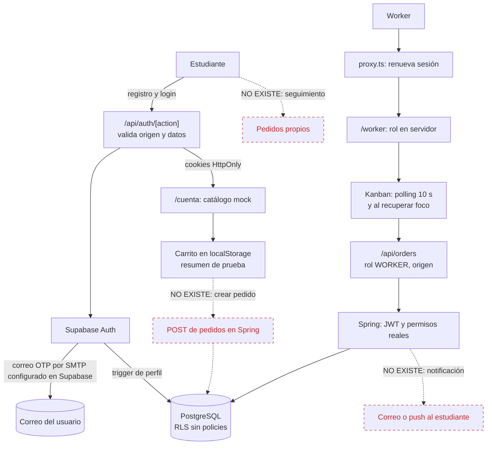

# Auditoría del frontend de UniFood

- **Fecha:** 2026-11-03
- **Rama y commit:** `feature/admin-dashboard` @ `618d47c`, con los cambios locales de los paneles admin que ya existían.
- **Alcance:** `unifood-web/` (188 archivos TS/TSX de producción, unas 16.200 líneas, 19 páginas, 16 Route Handlers), más las migraciones SQL de `unifood-backend/supabase/`, necesarias para evaluar RLS.
- **Complemento:** los hallazgos de servidor se detallan en `AUDITORIA-BACKEND.md`. Aquí se citan como «backend A1», «backend M11», etc.

Todas las rutas son relativas a `unifood-web/`, salvo que se indique otra cosa.

**Nivel de evidencia de cada hallazgo**

| Marca | Significado |
| --- | --- |
| **[E]** | Comprobado ejecutando una herramienta |
| **[L]** | Comprobado leyendo el código |
| **[I]** | Inferencia razonada, pendiente de confirmar en el entorno real |

**Qué se ejecutó y qué no**

| Acción | Resultado |
| --- | --- |
| `tsc --noEmit` | Sin errores |
| `eslint` | Sin errores ni avisos |
| 37 archivos de test Node sin base de datos | **415 tests, 0 fallos** |
| `npm audit` y `npm outdated` | Ver A1 |
| 10 archivos de test que aplican migraciones | **No ejecutados**: lo prohíben las reglas de esta fase |
| 164 tests Playwright | **No ejecutados**: exigen detener el servidor del puerto 3000, que estaba en uso |
| `next build` | **No ejecutado**: los tamaños salen del build existente del 26/10, anterior a los últimos cambios |
| Supabase real | **Sin acceso**: no se comprobó configuración remota, plantillas, SMTP ni límites |

Tampoco se leyeron los valores de `.env.local`, solo los nombres de las variables. Este informe es el único archivo creado.

---

## Premisas del encargo que no coinciden con el repositorio

| Premisa | Realidad | Evidencia |
| --- | --- | --- |
| Correos con Resend | **Resend no aparece en el código, dependencias ni variables.** Las coincidencias son el método `auth.resend` de Supabase. Los únicos correos son los de Auth. Si Resend se usa como SMTP, está configurado en el panel de Supabase y no pude verificarlo | `docs/auth.md:88`, búsqueda global |
| Notificaciones de pedido por correo | **No existen** | Sin código de envío; backend A4 |
| Creación de pedido | **No existe.** El carrito y el resumen son simulados, con catálogo de ejemplo | `features/client/mocks/catalog.ts:1`, `features/client/components/CheckoutConfirmation.tsx:31` |
| Tablero Kanban con cambios de estado | Existe, **sin arrastrar y soltar**: columnas con botones, actualizadas por polling cada 10 s | `components/worker/KanbanBoard.tsx`, `features/orders/hooks/useOrders.ts:107-109` |
| Server Actions | **Ninguna.** Todas las mutaciones pasan por Route Handlers | 0 directivas `"use server"` |
| Validación con zod o similar | **No se usa zod.** Hay parsers escritos a mano en `contracts.ts` | `package.json:17-25` |

---

## 1. Resumen ejecutivo

La base de seguridad es buena: Next.js actúa como BFF, los tokens viven en cookies HttpOnly, el rol se comprueba en servidor en cada página y API, no hay secretos en el cliente, no hay vectores de XSS evidentes y las tablas de negocio están cerradas al navegador.

**No encontré hallazgos críticos propios de la aplicación.** La prioridad inmediata es actualizar Next.js y `sharp`: la versión instalada está dentro del rango de avisos críticos publicados el 14 de octubre, aunque las condiciones conocidas de explotación no parecen darse aquí.

Los riesgos principales son la falta de límites propios en login, OTP y envío de correos, y un flujo de negocio incompleto: no hay creación ni seguimiento de pedidos, ni recordatorios ni notificaciones. El Kanban funciona, pero un fallo de polling o una sesión vencida lo deja inutilizable sin guía para el worker. Tampoco hay CI, despliegue definido ni monitoreo. Las áreas de `features/` son de alta calidad; la deuda se concentra en la UI antigua del worker.

---

## 2. Mapa de arquitectura y stack

### 2.1 Stack real

| Área | Tecnología instalada |
| --- | --- |
| Framework | Next.js 16.3.8 (App Router, Turbopack), React 19.2.8 |
| Lenguaje | TypeScript 5.9.3 en modo `strict` |
| UI | CSS Modules, `lucide-react` 1.47. Tailwind 4.3.3 está instalado pero no se importa en ningún CSS (B17). Sin librería de componentes |
| Estado | Hooks de React, y clases `Store` con `useSyncExternalStore` en cada feature. Sin Redux, Zustand ni React Query |
| Formularios | Estado controlado a mano, sin librería |
| Validación | Parsers propios en `contracts.ts` y `features/auth/validation.ts` |
| Auth | Supabase con `@supabase/ssr` 0.12.7 y `supabase-js` 2.117.2 |
| Backend | Spring Boot por `API_URL`, solo desde servidor |
| Pruebas | `node:test` (313 declaraciones en 47 archivos), Playwright 1.63 (164 declaraciones), PGlite y PostgreSQL nativo |
| Calidad | ESLint 9, Prettier 3.9.9 |

**Modelo de renderizado:** 54 Client Components y Server Components mínimos, usados como guardas de autenticación. Casi todas las páginas son `force-dynamic`.

**Variables:** `API_URL`, `SUPABASE_URL`, `SUPABASE_PUBLISHABLE_KEY` y `AUTH_USERNAME_DOMAIN`, todas de servidor. **No existe ninguna variable `NEXT_PUBLIC_`.**

### 2.2 Estructura

```text
unifood-web/
├─ app/            Páginas, layouts y Route Handlers (BFF)
├─ features/       Módulos por dominio: auth, client, orders, availability,
│                  worker-history, worker-profile, admin-*, panel-*
├─ components/worker/   UI antigua del worker: Kanban, llamadas, detalle
├─ config/         Validación de entorno
├─ lib/ types/     Utilidades y tipos de pedidos
├─ proxy.ts        Renovación de sesión (antes middleware)
└─ tests/          Node, e2e con Playwright y helpers
```

### 2.3 Flujo auth → pedido → Kanban → correo

Las líneas continuas existen hoy. Las discontinuas en rojo **no existen**.



### 2.4 Comunicación

- **Con Supabase desde servidor:** `features/auth/server/client.ts`, con timeout de 15 s y `no-store`.
- **Con Supabase desde navegador:** solo la recuperación del panel (`features/panel-recovery/client.ts`), con PKCE y sesión en memoria.
- **Con Spring:** siempre desde Route Handlers con el token de la sesión verificada. El navegador nunca ve el token.
- **Errores:** los módulos nuevos traducen a mensajes fijos y validan el contrato. Pedidos no lo hace (M5).
- **Reintentos:** no hay automáticos en mutaciones, lo cual es correcto. El polling actúa como reintento de lecturas.
- **Caché:** ninguna por diseño, todo con `no-store`; la revalidación es manual o por foco.

### 2.5 Control de acceso por capa

| Capa | Responsabilidad | Evidencia |
| --- | --- | --- |
| `proxy.ts` | Renueva sesión, limpia cookies inválidas, bloquea anónimos en `/api/orders`. **No autoriza roles** | `proxy.ts:45-97` |
| Páginas | Comprueban sesión, cuenta activa y rol exacto | `app/worker/page.tsx:9-10`, `features/admin/server/requireAdmin.ts:6-10` |
| Route Handlers | Repiten sesión, rol y origen en mutaciones | `app/api/orders/[[...path]]/route.ts:30-49` |
| Spring | Decide con datos frescos | `AUDITORIA-BACKEND.md`, sección 4 |
| PostgreSQL | Sin acceso de `anon` ni `authenticated` | Ver sección 4 |

---

## 3. Hallazgos por severidad

### Crítico

Ninguno propio de la aplicación. A1 corresponde a avisos críticos de terceros, cuyas condiciones conocidas no parecen cumplirse aquí. Esta conclusión no cubre la configuración remota de Supabase.

### Alto

#### A1. Next.js 16.3.8 y `sharp` 0.35.4 dentro de avisos críticos [E]

- **Descripción:** `npm audit --omit=dev` informa 1 crítico y 2 altos. El [aviso oficial del 14 de octubre](https://nextjs.org/blog/nextjs-security-update-october-14-2026) se corrige en Next 16.4.1; `npm outdated` muestra 16.4.5 como última versión.
- **Evidencia:** `package.json:21`, `package-lock.json:6280-6282`.
- **Aplicabilidad a UniFood:**

| Aviso | Condición | ¿Aplica aquí? |
| --- | --- | --- |
| GHSA-673q-mjm6-r5xr, RCE en `use cache` | Cache Components | **No** [E]: sin `use cache` ni `cacheComponents`. El proveedor pide actualizar igualmente |
| GHSA-2464-fhr4-w9xw, RCE en Image Optimization | Uso de SVG, Linux con glibc, `sharp` < 0.35.5 | **Probablemente no, sin poder descartarlo.** No hay SVG, `dangerouslyAllowSVG` ni `remotePatterns`, pero el optimizador está activo y el sistema de producción es desconocido |
| GHSA-p3m5-59mp-jv5r, DoS en Server Actions | Al menos una Server Action | **No** [E]: 0 Server Actions |
| GHSA-68fv-2mgg-jv7q, DoS en `source-map-js` | Procesar source maps maliciosos | **Muy improbable** [I]: dependencia de compilación |

- **Riesgo e impacto:** no lo clasifico como crítico porque faltan las condiciones conocidas, pero es una RCE no autenticada en un componente expuesto y el coste de corregirla es bajo.
- **Corrección:** actualizar a `next` ≥ 16.4.5 y `eslint-config-next` a la par, verificar `sharp` ≥ 0.35.5 y ejecutar la verificación completa. La versión 15.x del proveedor no aplica aquí.
- **Nota:** Next 16.3.8 ya corrige el [paquete de septiembre](https://nextjs.org/blog/september-2026-security-release). Las 16 alertas moderadas restantes están en la cadena de ESLint, solo de desarrollo.

#### A2. Login, OTP y correos sin límites propios [L] + [I]

- **Descripción:** `/api/auth/[action]` no limita intentos. `sameOrigin` protege contra CSRF, pero un cliente fuera del navegador puede enviar cualquier `Origin`. Además, como las llamadas salen del servidor Next, Supabase ve la IP del servidor y no la del usuario.
- **Evidencia:** `app/api/auth/[action]/route.ts:78`, `222-234`, `235-243`, `250`. La [documentación de Supabase](https://supabase.com/docs/guides/auth/rate-limits) indica que limita por IP del cliente, que para llamadas de servidor hay que usar `Sb-Forwarded-For` **con una clave secreta**, y fija 30 sign-ins o sign-ups cada 5 minutos por IP por defecto.
- **Riesgo e impacto [I]:**
  - **Bloqueo general:** todos los usuarios comparten un cupo, así que un ataque, o simplemente la hora pico, puede dar 429 a todo el mundo.
  - **Protección diluida:** los límites no distinguen al atacante de los usuarios legítimos.
  - **Abuso de correo:** `recover` y `resend` envían correo a direcciones elegidas por quien llama, sin límite propio. Esto puede agotar la cuota del proyecto y bloquear los OTP legítimos, además de molestar a terceros.
  - **Fuerza bruta:** contraseñas y códigos de 6 dígitos dependen solo de los límites del proveedor.
- **Corrección:** límites propios antes de llamar a Supabase, por IP real y por cuenta, con almacén compartido si hay varias instancias. Añadir CAPTCHA en registro y recuperación. Evaluar el reenvío de IP, que obliga a usar una clave secreta en servidor, algo que hoy el diseño evita a propósito (pregunta 8). Medir en los logs de Auth qué IP se registra.

#### A3. Pedido inexistente de extremo a extremo [L]

- **Descripción:** catálogo, precios, stock y sedes son ejemplos. El carrito vive en `localStorage`. El estudiante no puede crear pedidos, consultar los suyos ni cancelar desde la UI, aunque el BFF de cancelación existe.
- **Evidencia:** `features/client/mocks/catalog.ts:1`, `features/client/domain/checkout.ts:85-135`, `features/client/components/ClientCheckout.tsx:223`, `README.md:39`.
- **Riesgo e impacto:** el producto no cumple su función principal, y el Kanban solo recibe pedidos insertados por otros medios. Los textos actuales sí advierten que es una prueba, lo cual es correcto y debe mantenerse hasta que exista el flujo real. Depende de backend A3.
- **Corrección:** al crear el flujo real, el navegador solo debe enviar identificadores, cantidades, notas y hora. Precios, totales y disponibilidad se calculan en servidor, con clave de idempotencia y sustitución de los mocks por un BFF con contrato.

#### A4. El llamado al estudiante no llega y los recordatorios no funcionan [L]

- **Descripción:** el botón de recordatorio está desactivado y su manejador solo escribe en consola. Tampoco hay acción de «no recogido». La tarjeta muestra «Estudiante avisado» aunque no se envía ningún aviso.
- **Evidencia:** `components/worker/WorkerDashboard.tsx:207-213`, `components/worker/CallsBoard.tsx:226-242`, `components/worker/OrderCard.tsx:109-111`, `README.md:33`.
- **Riesgo e impacto:** la interfaz afirma algo que no ocurrió. Los pedidos llamados que nadie recoge quedan en el tablero indefinidamente. Depende de backend A1 y A4.
- **Corrección:** cambiar el texto a «Llamado» hasta que exista notificación real. Después, conectar recordatorio y no recogido, mostrando intentos y tiempo restante, con `calledAt` y `reminderCount` en el contrato.

#### A5. Un fallo de polling o una sesión vencida inutilizan el Kanban [L]

- **Descripción:** cualquier error de lectura reemplaza todo el tablero por un texto, aunque ya hubiera datos cargados. No hay botón de reintento ni enlace al login. La vista de Llamadas ignora `error` y `loading`, y además deja su lista vacía sin texto a propósito.
- **Evidencia:** `components/worker/WorkerDashboard.tsx:324-342` y `367-394`, `features/orders/hooks/useOrders.ts:81-88`, `components/worker/CallsBoard.tsx:155-163`.
- **Riesgo e impacto:**
  - Un fallo puntual en hora pico oculta todos los pedidos hasta el siguiente ciclo.
  - Con sesión vencida, el worker queda ante «Inicia sesión para consultar los pedidos» sin salida, salvo recargar a mano.
  - En Llamadas, un fallo se ve igual que «no hay llamadas», o mantiene datos antiguos sin avisarlo.
  - «En línea» en la cabecera es un texto fijo, no refleja la conexión (`components/worker/Header.tsx:152-156`).
- **Corrección:** conservar los datos y mostrar un aviso no bloqueante con la hora de la última actualización. Redirigir en 401. Mostrar reintento y estado real de conexión, y un estado vacío en Llamadas.

#### A6. Sin CI, despliegue definido ni monitoreo de errores [L]

- **Descripción:** no hay pipeline, Dockerfile ni plataforma definida. Los `catch` del BFF descartan el error y no hay ninguna llamada de log en servidor. `instrumentation.ts` solo valida el entorno, y `error.tsx` ignora el error recibido.
- **Evidencia:** ausencia de `.github/` y equivalentes, `instrumentation.ts:3-6`, `app/error.tsx:3-8`, `app/api/auth/[action]/route.ts:280-287`. El único `console` de producción es el de `WorkerDashboard.tsx:209`.
- **Riesgo e impacto:** las verificaciones de la DoD son manuales. Un fallo real en producción no deja rastro, y `npm run start` escucha en todas las interfaces sin TLS propio.
- **Corrección:** CI con `lint`, `tsc`, `npm test`, `build` y e2e. Definir hosting con HTTPS. Añadir `onRequestError`, logs estructurados sin datos personales y un servicio de errores.

### Medio

#### M1. Sin cabeceras de seguridad [E]

- **Descripción:** `next.config.ts` no define `headers()` y `proxy.ts` solo añade `Cache-Control`. La única cabecera defensiva está en la descarga de imágenes.
- **Evidencia:** `next.config.ts:14-18`, `proxy.ts:101-106`, `features/admin-catalog/server/images.ts:188-191`.
- **Riesgo e impacto:** no hay segunda barrera si aparece un XSS. El clickjacking está mitigado en parte por `SameSite=Lax`, que evita enviar cookies a iframes de otro sitio, pero depende de un solo control. También falta HSTS.
- **Corrección:** CSP con nonce o `strict-dynamic`, primero en modo report-only; `frame-ancestors 'none'`, `X-Content-Type-Options`, `Referrer-Policy`, `Permissions-Policy`, HSTS y `poweredByHeader: false`. La CSP debe permitir `connect-src` hacia Supabase en la recuperación del panel.

#### M2. Se puede cambiar la contraseña sin prueba adicional [L]

- **Descripción:** `action=reset` solo exige una sesión válida. No verifica que provenga de una recuperación por OTP ni pide la contraseña actual.
- **Evidencia:** `app/api/auth/[action]/route.ts:153-173`, en especial `168`.
- **Riesgo e impacto:** con una sesión abierta en un equipo compartido o un dispositivo robado, alguien puede cambiar la contraseña. El resultado de `signOut({ scope: "global" })` tampoco se comprueba, por lo que un fallo dejaría otras sesiones activas.
- **Corrección:** ligar `reset` a una prueba reciente de recuperación, activar «Secure password change» en Supabase si encaja, y gestionar el error de `signOut`.

#### M3. Registro directo con la clave pública y documento como oráculo [L] + [I]

- **Descripción:** la clave publishable es pública por diseño y se entrega en `/panel/recuperar`. Con ella se puede llamar a Supabase sin pasar por el BFF. El trigger solo valida el dominio cuando `registration_type` es `student`; en otro caso crea una identidad inactiva con cualquier correo.
- **Evidencia:** `app/panel/recuperar/page.tsx:11-18`, `unifood-backend/supabase/migrations/007_auth_role_cardinality.sql:134-135`, `app/api/auth/[action]/route.ts:204-211`.
- **Riesgo e impacto:** creación de cuentas basura y envío de correos a direcciones ajenas, sin obtener acceso. Además, un documento duplicado aborta el alta y acaba en un mensaje genérico. Eso deja a un estudiante legítimo sin explicación si alguien usó su documento, y permite comprobar si un documento existe.
- **Corrección:** restringir el alta directa con un hook de Supabase, un trigger o el aprovisionamiento administrativo. Definir un flujo de soporte para documentos reclamados.

#### M4. Admisión duplicada en cuatro BFF con dos modelos de identidad [L]

- **Descripción:** el bloque de sesión, RPC y rol se repite casi igual. Worker y pedidos usan `getAuth`; admin y perfiles usan `getVerifiedAuthIdentity` más la RPC.
- **Evidencia:** `features/admin-catalog/server/forward.ts:63-81`, `features/admin-catalog/server/images.ts:76-93`, `features/admin-dashboard/server/forward.ts:43-68`, `features/panel-profile/server/forward.ts:48-76`.
- **Riesgo e impacto:** hoy coinciden, pero un cambio de política podría aplicarse solo en parte.
- **Corrección:** una función común `admitBff(predicate)` que devuelva identidad o fallo tipado.

#### M5. Pedidos es el único módulo sin contrato validado [L]

- **Descripción:** el BFF de pedidos reenvía el cuerpo de Spring sin validar, incluidos `clientId` y `cafeteriaId`, y sin `redirect: "error"`. El navegador asume el tipo sin comprobarlo, muestra texto crudo en errores y un estado desconocido rompe toda la lista.
- **Evidencia:** `app/api/orders/[[...path]]/route.ts:92-98`, `features/orders/api/orderApi.ts:27-39` y `60`, `features/orders/utils/orderMapper.ts:32-33`.
- **Riesgo e impacto:** un cambio del backend o un registro inesperado puede dejar sin servicio el Kanban. Se exponen datos que la UI no usa. Backend A5 agrava el caso, porque devuelve 500 ante errores simples.
- **Corrección:** crear `features/orders/contracts.ts` y `errors.ts` siguiendo `availability`, y reducir la respuesta a lo necesario.

#### M6. El polling es costoso y sigue con la pestaña oculta [L]

- **Descripción:** cada ciclo de pedidos genera `getUser` en el proxy, `getUser` y RPC en `getAuth`, y dos llamadas a Spring. Son 5 llamadas de red cada 10 s por pestaña, unas 14.400 en 8 horas. Pedidos no revisa la visibilidad, a diferencia de otros módulos.
- **Evidencia:** `proxy.ts:46`, `features/auth/server/session.ts:20-26`, `app/api/orders/[[...path]]/route.ts:60-92`, `features/orders/hooks/useOrders.ts:107-113`. Comparar con `features/worker-history/useWorkerHistory.ts:24`.
- **Riesgo e impacto:** carga innecesaria sobre Auth y Spring, y posible 429 según los límites del plan [I].
- **Corrección:** pausar con `visibilitychange`, añadir un pequeño retraso aleatorio y un retroceso ante errores. Evitar `getUser` duplicado. A futuro, evaluar SSE desde Spring, ya que Realtime directo no encaja con tablas cerradas.

#### M7. Deuda concentrada en la UI antigua del worker [L]

- **Descripción:** `WorkerDashboard.tsx` tiene 796 líneas, con 18 bloques `style={{}}` y modales en línea. El filtro de búsqueda está repetido tres veces. El directorio no sigue Prettier, a diferencia de `features/`.
- **Evidencia:** `components/worker/WorkerDashboard.tsx:80-169`, `486-793`, `components/worker/CallsBoard.tsx:100-119`. Código sin uso: `getOrders` en `features/orders/api/orderApi.ts:71`, `advanceOrder` y `getColumnStatuses` en `lib/orderWorkflow.ts:95-143`, `Order.note` y `calledAt` en `types/order.ts`, que el mapper nunca rellena.
- **Riesgo e impacto:** es la pantalla más crítica para la operación y la más difícil de cambiar. `OrderDetail` y `CallsBoard` soportan `order.note`, un campo que nunca llega.
- **Corrección:** mover todo a `features/orders/`, separar modales y extraer un `matchesOrder` común, sin cambiar comportamiento.

#### M8. Accesibilidad con huecos en los flujos del worker [L] + [E]

- **Descripción:**

| Problema | Evidencia |
| --- | --- |
| El modal de cancelar no mueve el foco, no atrapa el tabulador y no cierra con Escape | `components/worker/WorkerDashboard.tsx:486-650` |
| El error de acción es un overlay sin gestión de foco | `WorkerDashboard.tsx:656-793` |
| El tablero no anuncia pedidos nuevos ni cambios de estado, y no tiene etiqueta | `components/worker/KanbanBoard.tsx:65` |
| Contraste 3,82:1 en texto de 14 px (mínimo 4,5:1) [E] | `#7a8394` sobre blanco, `WorkerDashboard.tsx:570-571` |
| Navegación inferior con texto de 10 px | `components/worker/BottomNav.module.css:133` |
| Campos del login sin `aria-invalid` ni error asociado | `features/auth/components/AuthScreen.tsx:745` |
| Sin pruebas automáticas de accesibilidad | Sin `axe` |

- **Riesgo e impacto:** usuarios de teclado y lector de pantalla pierden contexto en acciones irreversibles. El Kanban en sí **es** operable por teclado porque usa botones, lo cual es una ventaja frente al arrastre.
- **Corrección:** reutilizar el patrón `<dialog>` de `features/client/components/ClientDialog.tsx`, añadir una región `aria-live`, corregir contraste e integrar `@axe-core/playwright`.

#### M9. Documento del estudiante visible en cada tarjeta [L]

- **Descripción:** el número de documento aparece en tarjetas, llamadas y detalle.
- **Evidencia:** `components/worker/OrderCard.tsx:78-80`, `components/worker/CallsBoard.tsx:215-220`, `features/orders/utils/orderMapper.ts:43`.
- **Riesgo e impacto:** en una pantalla de cafetería, otras personas pueden verlo. Relacionado con backend M11.
- **Corrección:** mostrar solo los últimos dígitos, y el dato completo en el detalle si realmente hace falta para entregar (pregunta 11).

### Bajo

| ID | Hallazgo | Evidencia | Corrección |
| --- | --- | --- | --- |
| B1 | La columna «Entregados» muestra un contador de máximo 5, aunque haya más | `components/worker/KanbanBoard.tsx:86,141` | Mostrar el total real |
| B2 | Se ofrece «Cancelar» después del plazo; el error llega tras el clic | `components/worker/OrderCard.tsx:158-192` | Mapear `cancellationDeadline` |
| B3 | Entregar y preparar son irreversibles y sin confirmación | `components/worker/OrderCard.tsx:116-126` | Decidir con operación (pregunta 10) |
| B4 | «Mantener sesión» marcado por defecto, también en el panel: 30 días en posibles equipos compartidos | `features/auth/components/AuthScreen.tsx:215`, `features/auth/server/config.ts:35` | Desmarcado en panel |
| B5 | `request.text()` lee todo el cuerpo antes de comprobar el tamaño, sin autenticación | `app/api/auth/[action]/route.ts:100-101` | Reutilizar la lectura limitada de `features/admin-catalog/server/body.ts` |
| B6 | No se rechaza una clave secreta en `SUPABASE_PUBLISHABLE_KEY`. El navegador está protegido, pero el servidor la usaría | `config/environment.ts:38-47`, comparar `features/panel-recovery/config.ts` | Reutilizar esa validación |
| B7 | `/api/worker/*` y `/api/admin/*` fuera del matcher del proxy. Se protegen solos, así que es una inconsistencia y no una brecha | `proxy.ts:110-123` | Documentar o unificar |
| B8 | Sin `not-found.tsx` raíz ni `global-error.tsx`; `/worker` sin título propio | `app/`, `app/worker/page.tsx` | Añadirlos en español |
| B9 | 11 imágenes mock de 2 a 3 MB, unos 30 MB en total. `next/image` lo mitiga, pero consume CPU al optimizar | `public/images/client/` | Reemplazar por fotos reales optimizadas |
| B10 | WORKER no ve imágenes gestionadas, y su filtro descarta URLs remotas | `features/availability/presentation.ts`, backend M10 | Resolver junto con el backend |
| B11 | Contratos escritos a mano, sin generación desde Spring | `features/*/contracts.ts` | Evaluar OpenAPI |
| B12 | `next dev` y `next start` escuchan en todas las interfaces, también en la red local | `package.json:7,10` | Aceptable en desarrollo; proteger en producción |
| B13 | Documentación desactualizada: `README.md:41` dice que no hay locking, y `docs/client-frontend.md:128` cita una variable que ya no está | `README.md`, `docs/client-frontend.md` | Actualizar |
| B14 | Rutas `C:\Users\credi\...` en la documentación | `README.md:7` | Generalizar |
| B15 | Dependencias con parches menores pendientes: `supabase-js`, `lucide-react`, Playwright | `npm outdated` | Actualizar junto con A1 |
| B16 | Test visual solo con snapshots `win32`, y e2e sobre `next dev` por defecto | `tests/e2e/login-layout.spec.ts-snapshots/`, `playwright.config.ts:29-32` | Generar para CI; usar `PLAYWRIGHT_PRODUCTION` |
| B17 | Tailwind instalado y configurado en PostCSS, sin importarse en ningún CSS | `package.json:29,36`, `postcss.config.mjs`, `app/globals.css` | Retirarlo o adoptarlo de forma explícita |
| B18 | Carpetas vacías sin versionar en la raíz del repositorio: `src/` y `supabase/`, del 29/09, que pueden confundirse con las reales | raíz del repositorio | Eliminarlas tras confirmar |

---

## 4. Lo que está bien hecho y debe conservarse

### Respuestas directas de seguridad

| Pregunta | Respuesta | Evidencia |
| --- | --- | --- |
| ¿La service role key llega al cliente? | **No.** Ninguna variable pública, el código no la usa y `.env.local` solo contiene una clave `sb_publishable`. En el build, «sb_secret» aparece solo como prefijo dentro del SDK | Búsqueda en código y `.next/static` |
| ¿Secretos o `.env` versionados? | **No.** Revisión del historial completo en la auditoría de backend: solo fixtures sintéticos | `git log --all` con patrones |
| ¿Las cookies son seguras? | **Sí.** `HttpOnly`, `SameSite=Lax`, `Secure` en producción | `features/auth/server/config.ts:26-38` |
| ¿El rol se verifica en servidor? | **Sí**, en páginas y API, no solo ocultando botones | Sección 2.5 |
| ¿Se confía en la sesión sin verificar? | **No.** `getUser` valida contra Auth antes de usar `getSession` | `features/auth/server/session.ts:20-38` |
| ¿Hay XSS? | **Sin vectores evidentes.** Sin `dangerouslySetInnerHTML`, `innerHTML`, `eval` ni equivalentes; React escapa el contenido | Búsqueda sin resultados |
| ¿Hay CSRF? | **Protegido.** Comprobación de origen en mutaciones, más `SameSite=Lax` y JSON | `features/auth/validation.ts:101-120` |
| ¿CORS? | **Sin cabeceras abiertas.** El navegador solo llama a su propio origen | Sin `Access-Control-*` |
| ¿Hay enumeración de usuarios? | **Mitigada.** Mensajes neutros en login y recuperación. Excepciones: dominios habilitados y documento (M3) | `app/api/auth/[action]/route.ts:41-72`, `features/panel-recovery/flow.ts:36-44` |
| ¿Se validan entradas en servidor? | **Sí**, con parsers propios y listas cerradas de parámetros | `contracts.ts`, `commands.ts` |

### RLS en Supabase

- **Todas las tablas de negocio tienen RLS activo y sin policies**, con permisos de tabla y columna revocados a `PUBLIC`, `anon` y `authenticated`. Las posteriores repiten el cierre (`010`, `013`, `017`).
- Un usuario **no puede** leer ni modificar pedidos ajenos desde el navegador, porque no tiene acceso directo a ninguna tabla. Las únicas RPC públicas son `is_institutional_email` y `current_auth_profile`.
- Esto describe las migraciones del repositorio. **No verifiqué** que estén aplicadas en el proyecto real. Hay que ejecutar `unifood-backend/supabase/audit_business_integrity.sql` contra cada entorno (pregunta 6).

### Arquitectura y calidad

- **BFF estricto:** el navegador nunca elige cafetería ni identidad, y no recibe tokens.
- **Sesión resiliente:** distingue fallo temporal de sesión inválida, sin expulsar al usuario por una caída del proveedor.
- **Recuperación del panel:** PKCE, sesión solo en memoria, limpieza de la URL, `referrer: no-referrer` y lista cerrada de claves publicables hacia el cliente.
- **Módulos `features/` recientes:** contratos estrictos, errores tipados, stores testeables y `redirect: "error"`.
- **Polling cuidadoso:** evita respuestas viejas, bloquea acciones simultáneas y gestiona el cambio de día.
- **Tipado:** `strict` activo, **sin ningún `any`, `@ts-ignore` ni `eslint-disable`**, y sin `TODO` en producción.
- **Rendimiento:** JS por ruta contenido en el build del 26/10: login 64 KB, worker 115 KB, admin 93 KB (sin comprimir). `supabase-js` solo se carga en recuperación del panel. Las imágenes usan `next/image`.
- **Experiencia:** avisos claros de que el pedido es simulado, `loading.tsx` y `error.tsx` en cuenta, foco gestionado en la mayoría de los flujos, `<dialog>` nativo en cliente y pruebas responsive en varios anchos.
- **Pruebas:** cobertura amplia de BFF, contratos, estados e invariantes SQL, con casos adversariales.

---

## 5. Plan de acción priorizado

**S:** hasta 1 día. **M:** 2-5 días. **L:** más de 1 semana. Las estimaciones son orientativas, para dos personas.

### Fase 0: inmediata

| # | Acción | Hallazgos | Esfuerzo |
| --- | --- | --- | --- |
| 1 | Actualizar Next, `sharp` y dependencias menores, con verificación completa | A1, B15 | S |
| 2 | Crear CI con lint, `tsc`, tests y build | A6 | S-M |
| 3 | Añadir cabeceras básicas, y CSP en report-only | M1 | S |
| 4 | Verificar en Supabase: migraciones, confirmación de email, límites y SMTP | Sección 6 | S |

### Fase 1: acceso y operación estable

| # | Acción | Hallazgos | Esfuerzo |
| --- | --- | --- | --- |
| 5 | Limitar login, OTP y correos; añadir CAPTCHA | A2, B5 | M |
| 6 | Hacer resiliente el Kanban: errores, 401, conexión real | A5 | S-M |
| 7 | Corregir el texto «Estudiante avisado» | A4 | S |
| 8 | Añadir monitoreo y logs de servidor | A6 | M |
| 9 | Proteger `reset` y el alta directa | M2, M3 | M |

### Fase 2: base para crecer

| # | Acción | Hallazgos | Esfuerzo |
| --- | --- | --- | --- |
| 10 | Crear contratos y errores de pedidos | M5 | M |
| 11 | Unificar admisión del BFF | M4 | S |
| 12 | Migrar el worker a `features/orders` sin cambiar comportamiento | M7 | M |
| 13 | Optimizar polling | M6 | S |
| 14 | Corregir accesibilidad e integrar `axe` | M8 | M |

### Fase 3: producto

| # | Acción | Hallazgos | Esfuerzo |
| --- | --- | --- | --- |
| 15 | Recordatorios y no recogido, tras backend A1 | A4 | M |
| 16 | Catálogo real, creación de pedido y seguimiento | A3, B10 | L |
| 17 | Notificaciones reales | A4 | L |
| 18 | Minimizar datos personales | M9 | S |
| 19 | CSP en modo de bloqueo y hallazgos Bajo | M1, B1-B18 | M |

**Dependencias:** la acción 10 conviene antes de la 15 y la 16, y la 12 antes de cambios grandes en el Kanban. Las acciones 15 a 17 dependen del backend.

---

## 6. Preguntas abiertas

### Verificación remota

1. **Resend:** ¿se usa como SMTP en Supabase, o se planea integrarlo? Si es lo segundo, la clave debe quedar solo en servidor y los destinatarios deben salir de la base de datos, nunca de la petición.
2. ¿Está activado **Confirm email**, con OTP de 6 dígitos? ¿Qué límites de envío tiene el proyecto?
3. ¿La política de contraseñas está configurada también en Supabase? El BFF se puede omitir llamando directamente al proveedor.
4. ¿Están activas las **Redirect URLs** solo con los dominios reales?
5. ¿Se permiten registros públicos en Supabase, sin restricción, para cualquier correo?
6. ¿Las migraciones 001-017 están aplicadas por igual en cada entorno?
7. **Despliegue:** ¿dónde se publicará? Esto define la cabecera de IP real, HSTS, Linux con glibc para A1 y el uso de varias instancias.

### Decisiones de seguridad

8. ¿Aceptan una clave secreta en el servidor Next para reenviar la IP a Supabase, o prefieren límites propios con CAPTCHA?
9. ¿Qué retención y anonimización tendrán los datos personales?

### Producto y operación

10. ¿Entregar y preparar requieren confirmación o una forma de deshacer?
11. ¿El worker necesita el documento completo, o bastan el nombre y los últimos dígitos?
12. ¿Se necesita arrastrar y soltar en el Kanban? Recomiendo mantener botones por accesibilidad y por el orden FIFO.
13. ¿Cómo debe seguir el estudiante su pedido: polling, SSE, push? ¿Qué retraso es aceptable para el tablero?
14. ¿Qué dispositivos usa la cafetería, y son compartidos? Afecta a B4, M9 y al diseño táctil.
15. ¿Se mantendrá el inglés de `AuthScreen`? Es la única pantalla bilingüe.
16. ¿Cuántos workers y estudiantes simultáneos se esperan en hora pico?

---

## 7. Convenciones detectadas

**Estructura**

- Nuevas áreas en `features/<dominio>/`, con esta forma:

```text
features/<dominio>/
├─ api.ts            Cliente del navegador hacia el BFF
├─ contracts.ts      Parsers de respuesta
├─ errors.ts         Códigos y mensajes fijos
├─ state.ts          Store sin React
├─ types.ts
├─ use<Dominio>.ts   Hook con useSyncExternalStore
├─ presentation.ts   Formato para la UI
├─ server/forward.ts BFF, con "server-only"
└─ components/       Componentes y CSS Module
```

- `app/**/route.ts` delgados: delegan en `features/*/server/forward.ts`.
- Páginas como Server Components mínimos que autorizan y renderizan un Client Component.
- `components/worker/` es histórico; no añadir ahí código nuevo.

**Nombres**

| Elemento | Convención | Ejemplo |
| --- | --- | --- |
| Componentes | `PascalCase.tsx` | `WorkerHistoryPanel.tsx` |
| Estilos | `Nombre.module.css` | `Availability.module.css` |
| Hooks | `useNombre.ts` | `useAvailability.ts` |
| Rutas públicas | Español | `/cuenta`, `/panel/recuperar` |
| APIs | Inglés | `/api/worker/orders/history` |
| Código | Inglés | `forwardAvailability` |
| Textos de usuario | Español | Mensajes fijos en `errors.ts` |
| Errores | `MÓDULO_MOTIVO` | `ADMIN_CATALOG_IMAGE_TOO_LARGE` |

**Estilo de componentes**

- Funciones con `export default` en la UI antigua y de cliente; exportaciones con nombre en módulos recientes.
- CSS Modules; evitar `style={{}}`. Tokens en `app/globals.css`.
- Iconos de `lucide-react` con `aria-hidden` cuando son decorativos.
- `role="status"` y `role="alert"` para feedback; `<dialog>` para modales.
- Alias `@/` para importaciones. Prettier en cada archivo modificado.

**Seguridad y datos**

- Toda variable es de servidor; no crear `NEXT_PUBLIC_` sin decisión explícita.
- `import "server-only"` en todo módulo con sesión o API.
- En cada BFF, en este orden: `sameOrigin` si muta, sesión, rol, validación estricta, `fetch` con `cache: "no-store"`, `redirect: "error"` y `AbortSignal.timeout`.
- Nunca reenviar cuerpos ni cabeceras del navegador; reconstruir la petición. Nunca devolver errores crudos.
- Respuestas con `Cache-Control: no-store`.
- Horas de negocio en `America/Bogota`, decididas por el servidor.

**Pruebas y proceso**

- Node: `tests/<área>-<tipo>.test.mjs` (`-bff`, `-state`, `-ui`, `-contracts`). E2E: `tests/e2e/<flujo>.spec.ts`. Fixtures en `tests/helpers/`.
- Proveedor local en `127.0.0.1:3101`, nunca Supabase real.
- `AGENTS.md` obliga a consultar `node_modules/next/dist/docs/` antes de escribir código: esta versión difiere de versiones anteriores, por ejemplo `proxy.ts` y `retry` en `error.tsx`.
- Definition of Done: `lint`, `npm test`, `build` y `format:check`. Ver `ESTANDARES.md`.

---

## Anexo A. Pruebas

| Área | Cobertura existente | Hueco |
| --- | --- | --- |
| Auth y roles | Muy amplia, incluye perfiles adversariales y fallos de proveedor | Sin prueba de límites de intentos ni de `reset` sin recuperación |
| BFF | Muy amplia en admin, disponibilidad e historial | Pedidos sin validación de contrato |
| Kanban | `orders.test.mjs`, `orders-refresh.test.mjs`, `orders-context.test.mjs`, `roles.spec.ts`, `worker-orders-business-day.spec.ts` | Comportamiento visual ante error, sesión vencida y Llamadas |
| Cliente | Carrito, horarios, checkout de prueba | Flujo real, porque no existe |
| Accesibilidad | Comprobaciones manuales en algunos e2e | Sin `axe` |
| Rendimiento | Sin pruebas | Sin presupuesto de bundles ni Lighthouse |
| Cobertura numérica | No medida, no hay herramienta | Añadir `c8` o `--experimental-test-coverage` |

**Flujos críticos sin cubrir:** pérdida de conexión durante el polling, expiración de sesión con el Kanban abierto, doble worker en la misma tarjeta desde la UI y cualquier integración contra Supabase real.

## Anexo B. Fuentes externas

- [Next.js: actualización de seguridad del 14 de octubre de 2026](https://nextjs.org/blog/nextjs-security-update-october-14-2026)
- [Next.js: release de seguridad de septiembre de 2026](https://nextjs.org/blog/september-2026-security-release)
- [Supabase: límites de Auth](https://supabase.com/docs/guides/auth/rate-limits)
- Documentación local: `node_modules/next/dist/docs/01-app/03-api-reference/03-file-conventions/`
